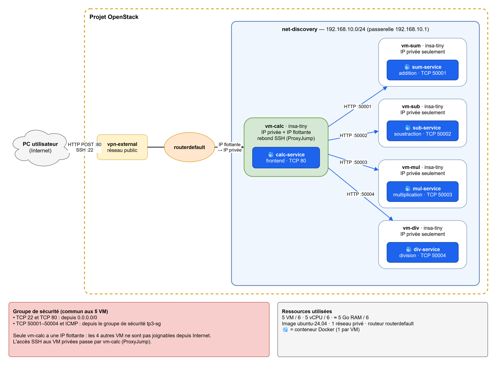
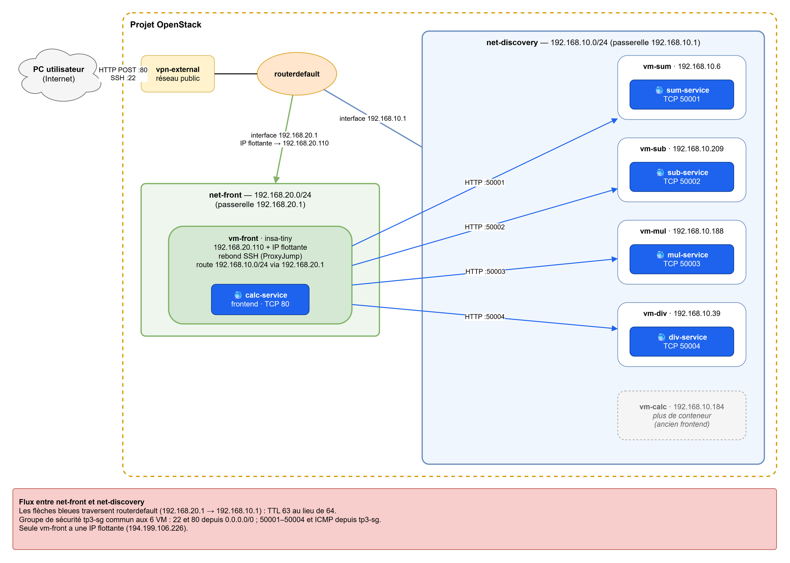

## Étape 1

L’application Calculator est composée de 5 microservices : `calc-service` reçoit l’expression et envoie chaque opération à `sum-service`, `sub-service`, `mul-service` ou `div-service`. Comme on ne peut avoir qu’un conteneur par VM, on a prévu 5 VM, une par service.

Schéma d’architecture (fait sur draw.io, le fichier source est [architecture.drawio](architecture.drawio)) :



| VM | Flavor | Conteneur | Port | Accès Internet |
|---|---|---|---|---|
| vm-calc | insa-tiny | calc-service (frontend) | 80 | oui (IP flottante) |
| vm-sum | insa-tiny | sum-service | 50001 | non |
| vm-sub | insa-tiny | sub-service | 50002 | non |
| vm-mul | insa-tiny | mul-service | 50003 | non |
| vm-div | insa-tiny | div-service | 50004 | non |

Toutes les VM sont en `ubuntu-24.04` sur le réseau `net-discovery` (192.168.10.0/24) du TP2, relié à `routerdefault`. On est limités à 6 VM, 6 vCPU et 6 Go de RAM : avec 5 insa-tiny (1 vCPU, 1 Go) on utilise 5 vCPU et 5 Go, et les services font des calculs très simples donc pas besoin de plus.

Quelques choix :
- Seul `calc-service` est utilisé directement par l’utilisateur, donc seule `vm-calc` a une IP flottante. Les 4 autres VM n’ont qu’une IP privée.
- On n’a pas assez d’IP flottantes pour toutes les VM, donc on passe par `vm-calc` pour se connecter en SSH aux autres (`ProxyJump`).
- Dans `CalcService.js`, les services sont appelés par leur nom (`http://calculator-sum:50001`, etc.). Au TP1 c’était Docker Compose qui résolvait ces noms, mais là les conteneurs sont sur des VM différentes. Il faudra donc associer chaque nom à l’IP privée de la bonne VM au lancement de `calc-service`.

Règles prévues dans le groupe de sécurité (`tp3-sg`) :

| Protocole | Port | Source | Pourquoi |
|---|---|---|---|
| TCP | 22 | 0.0.0.0/0 | SSH |
| TCP | 80 | 0.0.0.0/0 | accès à l’application |
| TCP | 50001-50004 | groupe `tp3-sg` | appels de calc-service vers les autres services |
| ICMP | - | groupe `tp3-sg` | ping entre les VM |

Pour les règles internes on met le groupe de sécurité comme source au lieu d’un CIDR, comme ça seules nos VM peuvent utiliser ces ports.


## Étape 2

On a créé les 5 VM sur Horizon (image `ubuntu-24.04`, flavor `insa-tiny-1.1.10`, réseau `net-discovery`, groupe `tp3-sg`, clé `tp3-key`) et associé l’IP flottante `194.199.106.226` à `vm-calc`.

| VM | IP privée | Conteneur | Port |
|---|---|---|---|
| vm-calc | 192.168.10.184 | calc | 80 |
| vm-sum | 192.168.10.6 | sum | 50001 |
| vm-sub | 192.168.10.209 | sub | 50002 |
| vm-mul | 192.168.10.188 | mul | 50003 |
| vm-div | 192.168.10.39 | div | 50004 |

Fichier `~/.ssh/config` sur le PC (les entrées vm-sub, vm-mul et vm-div sont pareilles que vm-sum avec leur IP) :

```
Host vm-calc
    HostName 194.199.106.226
    User ubuntu
    IdentityFile ~/.ssh/tp3-key.pem

Host vm-sum
    HostName 192.168.10.6
    User ubuntu
    IdentityFile ~/.ssh/tp3-key.pem
    ProxyJump vm-calc
```

Sur chaque VM on a installé Docker (mêmes commandes qu’au TP1), cloné `insa-labs`, puis build et lancé le conteneur du service. Par exemple sur vm-sum :

```bash
cd insa-labs/calculator/sum-service
sudo docker build -t sum-service .
sudo docker run -d --name sum --restart unless-stopped -p 50001:50001 sum-service
```

Pour `calc-service`, on utilise `--add-host` pour que les noms `calculator-xxx` pointent vers les IP privées des VM :

```bash
sudo docker run -d --name calc --restart unless-stopped -p 80:80 \
  --add-host calculator-sum:192.168.10.6 \
  --add-host calculator-sub:192.168.10.209 \
  --add-host calculator-mul:192.168.10.188 \
  --add-host calculator-div:192.168.10.39 \
  calc-service
```

On a vérifié avec `sudo docker ps` sur chaque VM que le conteneur était bien `Up` avec le bon port.

### 1. Quels sont les différents rôles de la VM connectée à Internet dans votre architecture?

`vm-calc` sert d’abord de point d’entrée pour l’application : c’est elle qui héberge le frontend, et c’est la seule que les utilisateurs peuvent joindre (IP flottante, port 80). Elle transmet ensuite chaque opération au bon service sur le réseau privé.

Elle sert aussi de passerelle SSH (bastion). Les autres VM n’ont pas d’IP publique, donc pour les administrer on se connecte d’abord à `vm-calc` puis on rebondit vers elles avec `ProxyJump`.

### 2. Quels avantages apporte ce déploiement par rapport à une exécution de tous les services sur une seule machine?

- Si un service ou sa VM plante, le reste continue de marcher, seule l’opération concernée ne répond plus.
- Chaque service a ses propres ressources (1 vCPU, 1 Go), un service très sollicité ne ralentit pas les autres.
- On peut redimensionner, mettre à jour ou dupliquer un service sans toucher aux autres (par exemple passer seulement vm-mul en insa-small).
- Seul le frontend est exposé à Internet, les services internes restent sur le réseau privé.

Par contre c’est beaucoup plus long à mettre en place : 5 VM à créer et configurer, et les IP à renseigner à la main.


## Étape 3

D’après le code, tout passe en HTTP sur TCP : `CalcService.js` écoute sur le port 80, et les 4 autres services sur 50001 à 50004. Les règles prévues à l’étape 1 (qu’on avait mises dans `tp3-sg` avant de créer les VM) suffisaient donc, on n’a rien eu à ajouter.

Tests, dans l’ordre demandé :

1. Chaque service en local, depuis le PC : `ssh vm-sum "curl -s -X POST -d '6 3' http://localhost:50001"`. On obtient 9, 3, 18 et 2 pour sum, sub, mul et div.
2. Ping depuis `vm-calc` vers les 4 autres VM : `2 packets transmitted, 2 received, 0% packet loss` pour chacune.
3. Chaque service depuis `vm-calc` via le réseau privé, par exemple `curl -s -X POST -d "6 3" http://192.168.10.6:50001`. Mêmes résultats qu’en local.
4. L’application complète depuis le PC :

```
> curl.exe -v -X POST -d "2+3" http://194.199.106.226:80
* Established connection to 194.199.106.226 (194.199.106.226 port 80)
< HTTP/1.1 200 OK
result = 5

> curl.exe -X POST -d "(8+4)*3-10/2" http://194.199.106.226:80
result = 31
```

Le deuxième calcul utilise les 4 services : 8+4=12 (sum), 12*3=36 (mul), 10/2=5 (div), 36-5=31 (sub).

### 1. Quels flux réseau sont nécessaires au fonctionnement de votre application?

- PC vers `vm-calc` en HTTP sur le port 80, via l’IP flottante et `routerdefault`.
- `vm-calc` vers `vm-sum` (TCP 50001), `vm-sub` (50002), `vm-mul` (50003) et `vm-div` (50004), en HTTP sur le réseau privé.

Les services d’opération ne communiquent pas entre eux, ils répondent seulement à `calc-service`. Les réponses n’ont pas besoin de règle car les groupes de sécurité OpenStack sont stateful (le retour d’une connexion autorisée passe automatiquement).

En plus de ça il y a les flux pour l’administration : SSH (22) du PC vers vm-calc puis vers les autres VM, ICMP entre les VM pour les tests, et la sortie vers Internet pour `apt`, `git clone` et les images Docker.

### 2. Pourquoi est-il préférable d’ouvrir uniquement les ports nécessaires plutôt que d’autoriser tout le trafic?

Chaque port ouvert est une porte d’entrée possible. Si tout était ouvert, n’importe quel programme qui écoute sur une VM (ou une faille dedans) serait accessible depuis Internet. C’est le principe du moindre privilège.

Chez nous, seuls 22 et 80 sont ouverts à tout le monde, et seule `vm-calc` a une IP publique. Les ports 50001-50004 ne sont acceptés que depuis les VM du groupe, donc personne ne peut appeler `sum-service` directement de l’extérieur, il faut passer par le frontend. Ça aide aussi à débugger : on sait exactement quels flux doivent exister.

### 3. Pouviez-vous utiliser Docker Compose pour déployer les services sur toutes les VM en simultané? Pourquoi?

Non. Docker Compose ne gère que le Docker de la machine sur laquelle on le lance : tous les conteneurs du `docker-compose.yml` seraient créés sur la même VM, sur un réseau Docker local à cette machine. Ça ne respecte pas la contrainte d’un conteneur par VM, et une insa-tiny devrait tout faire tourner.

On aurait pu mettre un docker-compose sur chaque VM avec un seul service, mais ça revient à faire 5 déploiements séparés, et il faudrait quand même donner les IP à la main. Pour déployer sur plusieurs machines à partir d’un seul fichier il faut un orchestrateur comme Docker Swarm ou Kubernetes, qui gère un cluster et le réseau entre les nœuds.


## Étape 4 (pour aller plus loin)



(source : [architecture-etape4.drawio](architecture-etape4.drawio))

### 4.1 Topologie cible

On a mis le frontend dans un deuxième réseau privé `net-front`, et laissé les 4 services dans `net-discovery`.

Deux différences avec l’énoncé :
- On a pris `192.168.20.0/24` et pas `192.168.10.0/24`, parce que cette plage est déjà celle de `net-discovery`. Le routeur ne peut pas avoir deux interfaces sur des sous-réseaux qui se chevauchent, il ne saurait pas où envoyer un paquet pour 192.168.10.x.
- Plutôt que de changer le réseau de `vm-calc` (et risquer de perdre l’accès SSH si Ubuntu ne configure pas la nouvelle interface), on a créé une nouvelle VM `vm-front`. Il restait de la place dans le quota pour une 6e VM.

Ce qu’on a fait sur Horizon :
1. Création de `net-front` avec le sous-réseau `subnet-front` : 192.168.20.0/24, passerelle 192.168.20.1.
2. Ajout d’une interface sur `routerdefault` dans `subnet-front` avec l’IP 192.168.20.1.
3. Création de `vm-front` sur `net-front` (même config que les autres), elle a eu l’IP 192.168.20.110.
4. Déplacement de l’IP flottante `194.199.106.226` de `vm-calc` vers `vm-front`.

Dans `~/.ssh/config`, `vm-front` remplace `vm-calc` comme proxy, et `vm-calc` passe en `ProxyJump vm-front` comme les autres.

### 4.2 Règles de routage

Avant d’ajouter la route, on a regardé la table de routage de `vm-front` :

```
ubuntu@vm-front:~$ ip route
default via 192.168.20.1 dev enp3s0 proto dhcp src 192.168.20.110 metric 100
192.168.20.0/24 dev enp3s0 proto kernel scope link src 192.168.20.110 metric 100
...
```

Et en fait le ping et le curl vers les services marchaient déjà (`curl ... http://192.168.10.6:50001` renvoyait 9). C’est parce que la route par défaut envoie tout ce qui n’est pas dans 192.168.20.0/24 vers 192.168.20.1, donc vers `routerdefault`, qui a aussi une interface dans `net-discovery` et transmet le paquet. Le groupe de sécurité laisse passer car la règle porte sur le groupe `tp3-sg`, pas sur une plage d’IP.

On a quand même ajouté la route demandée (il faut installer `net-tools` pour avoir la commande `route`) :

```bash
sudo apt install -y net-tools
sudo route add -net 192.168.10.0/24 gw 192.168.20.1
```

```
ubuntu@vm-front:~$ route -n
Destination     Gateway         Genmask         Flags Metric Ref    Use Iface
0.0.0.0         192.168.20.1    0.0.0.0         UG    100    0        0 enp3s0
192.168.10.0    192.168.20.1    255.255.255.0   UG    0      0        0 enp3s0
192.168.20.0    0.0.0.0         255.255.255.0   U     100    0        0 enp3s0
...
ubuntu@vm-front:~$ ping -c 2 192.168.10.6
64 bytes from 192.168.10.6: icmp_seq=1 ttl=63 time=2.08 ms
64 bytes from 192.168.10.6: icmp_seq=2 ttl=63 time=0.793 ms
```

On voit que le TTL est à 63 alors qu’il était à 64 depuis `vm-calc` : le paquet passe bien par un routeur. Attention, cette route n’est pas permanente, elle disparaît si la VM redémarre.

Ensuite on a installé Docker sur `vm-front`, lancé `calc-service` avec les mêmes `--add-host` qu’avant (les IP des services n’ont pas changé), et supprimé l’ancien conteneur sur `vm-calc` (`docker stop calc && docker rm calc`).

Test depuis le PC :

```
> curl.exe -v -X POST -d "2+3" http://194.199.106.226:80
< HTTP/1.1 200 OK
result = 5

> curl.exe -X POST -d "(8+4)*3-10/2" http://194.199.106.226:80
result = 31
```

L’application marche toujours. L’intérêt c’est que la seule VM exposée à Internet est maintenant seule dans son réseau : si elle était compromise, l’attaquant ne serait pas directement sur le même réseau que les services internes. Pour aller encore plus loin, on pourrait faire deux groupes de sécurité séparés, un pour le frontend (22 et 80 ouverts) et un pour les services (50001-50004 accessibles seulement depuis le groupe du frontend).
